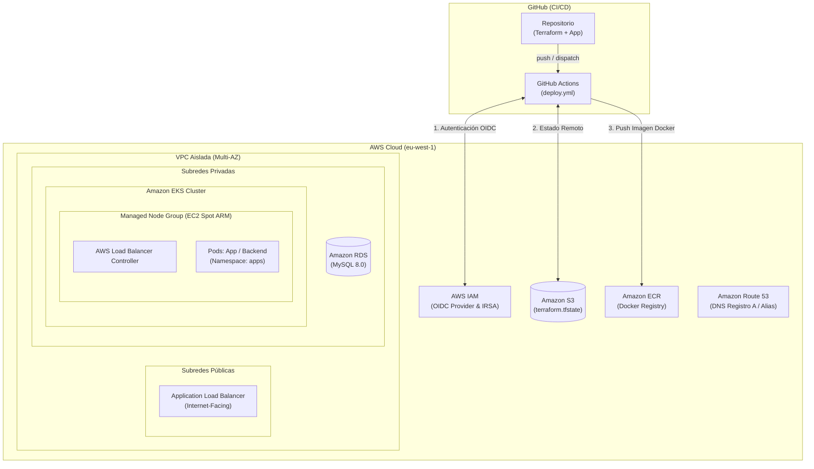

# Despliegue Automatizado de Amazon EKS con Terraform y GitHub Actions (OIDC)

Implementa una infraestructura completa de **Amazon Elastic Kubernetes Service (EKS)** en AWS utilizando **Terraform** como herramienta de Infraestructura como Código (IaC) y **GitHub Actions** para la integración y entrega continua (CI/CD).

La arquitectura está diseñada siguiendo buenas prácticas de seguridad, optimización de costos y automatización sin credenciales estáticas.

---

## Arquitectura y Características Principales

* **Orquestación de Contenedores (Amazon EKS):** Plano de control gestionado en la región `eu-west-1` (Irlanda) con autenticación basada en API (`API_AND_CONFIG_MAP`).
* **Red Aislada (VPC):** Configuración de red con subredes públicas y privadas en múltiples zonas de disponibilidad, etiquetadas para el descubrimiento automático de balanceadores de carga (`kubernetes.io/role/elb`).
* **Optimización de Costos (Compute):** Uso de instancias EC2 Spot y arquitectura ARM en los *Managed Node Groups* para reducir el gasto operativo.
* **Autenticación Sin Secretos (OIDC):** Conexión segura entre GitHub Actions y AWS IAM mediante OpenID Connect, eliminando la necesidad de almacenar llaves `AWS_ACCESS_KEY_ID` de larga duración.
* **Gestión de Tráfico (AWS Load Balancer Controller):** Despliegue automatizado mediante **Helm** utilizando *IAM Roles for Service Accounts (IRSA)* para aprovisionar *Application Load Balancers (ALB)* de forma dinámica a partir de recursos `Ingress` de Kubernetes.
* **Estado Remoto (Terraform Backend):** Almacenamiento centralizado del archivo `terraform.tfstate` en **Amazon S3** para permitir ejecuciones consistentes y destrucción limpia de recursos desde cualquier runner.

---

## Estructura del Proyecto

```text
.
├── .github/
│   └── workflows/
│       └── deploy.yml      # Pipeline de CI/CD para aplicar o destruir la infraestructura
├── main.tf                 # Definición de VPC, clúster EKS, roles IRSA y Helm releases
├── providers.tf            # Configuración de backend S3 y proveedores (AWS, Kubernetes, Helm)
├── apps.tf                 # Manifiestos de Kubernetes (Namespace, Deployment, Service e Ingress)
└── variables.tf            # Variables de parametrización del entorno
```

---

## Requisitos Previos

1. **Cuenta de AWS** con permisos administrativos para aprovisionar redes, roles IAM y clústeres EKS.
2. **Bucket de Amazon S3** creado previamente en la región `eu-west-1` para almacenar el estado remoto de Terraform.
3. **Proveedor OIDC en AWS IAM** configurado para `https://githubusercontent.com` con audiencia `://amazonaws.com`.
4. **Rol de IAM para GitHub Actions** con política de confianza (*Trust Policy*) vinculada al repositorio y secreto `AWS_ROLE_ARN` registrado en **Settings > Secrets and variables > Actions** del repositorio.

---

## Uso del Pipeline (CI/CD)

El flujo de trabajo en `.github/workflows/deploy.yml` soporta ejecución automática y manual:

* **Despliegue automático (`push` a `main`):** Cualquier cambio enviado a la rama principal ejecuta `terraform init` y `terraform apply -auto-approve`.
* **Control manual (`workflow_dispatch`):** Desde la pestaña **Actions > EKS Infrastructure > Run workflow**, es posible seleccionar explícitamente entre:
  * `apply`: Crea o actualiza toda la infraestructura y las aplicaciones en el clúster.
  * `destroy`: Elimina de forma ordenada los balanceadores, nodos, clúster EKS y componentes de red para evitar costos innecesarios cuando el entorno no está en uso.

---
## Diagrama de Arquitectura


    User(("Usuario / Navegador")) -->|HTTPS / HTTP| Route53
    Route53 -->|Apunta al DNS| ALB
    ALB -->|Enruta tráfico| DemoApp
    DemoApp <-->|Consultas SQL (Puerto 3306)| RDS
    ECR -.->|Pull Imagen| DemoApp
    ALBController -.->|Gestiona| ALB
    Actions -->|4. Terraform Apply / Destroy| EKS
